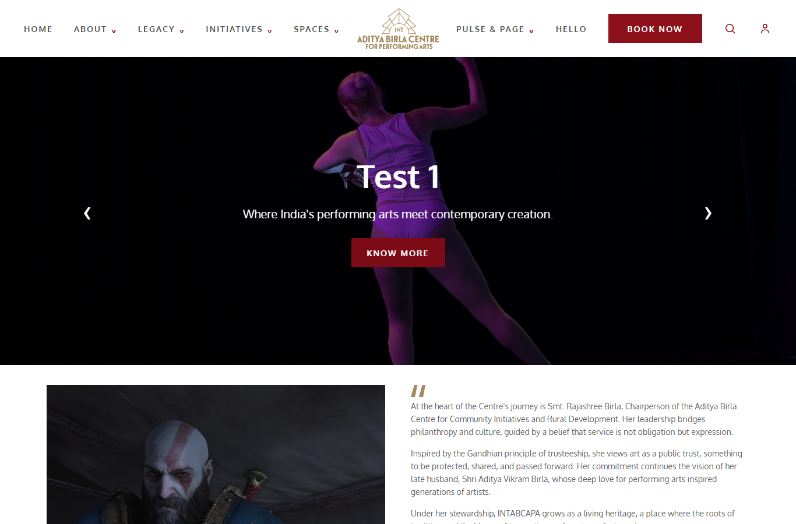

# INT Aditya Birla Centre for Performing Arts

[](https://react.dev/)
[](https://vite.dev/)
[](https://nodejs.org/)
[](https://expressjs.com/)
[](https://www.mongodb.com/)

A responsive performing-arts website for discovering shows, venues, cultural programming, and centre information. The project includes a React/Vite frontend, an Express API, Firebase authentication, and optional MongoDB persistence.

## Contents

- [Features](#features)
- [Technology](#technology)
- [Screenshots](#screenshots)
- [Project status](#project-status)
- [Project structure](#project-structure)
- [Prerequisites](#prerequisites)
- [Local setup](#local-setup)
- [Environment variables](#environment-variables)
- [Run the application](#run-the-application)
- [API overview](#api-overview)
- [Data and file storage](#data-and-file-storage)
- [Validation](#validation)
- [Deployment notes](#deployment-notes)
- [Contributing](#contributing)
- [License](#license)

## Features

- Homepage with a video hero, About and legacy content, show listings, performance spaces, dining, facility directory, editorial posts, and newsletter form.
- Editable About, homepage sections, and Pulse posts through the included admin screens.
- Email/password and Google sign-in flows backed by Firebase Authentication.
- Seat selection and booking confirmation screens for the listed productions.
- Account screens for profile, address, and booking information.
- Image and video upload endpoints with MIME/extension checks, file-size limits, and file-signature validation.
- Local browser-storage fallbacks for selected content and account data when the API is unavailable.

## Technology

| Area | Stack |
| --- | --- |
| Frontend | React 19, React Router 7, Vite 8, Tailwind CSS 4 |
| Authentication | Firebase Authentication |
| Backend | Node.js, Express 5, Multer |
| Database | MongoDB with Mongoose 9 |
| Linting | Oxlint |

## Screenshots

The screenshots below are captured from the running application at a 1366 × 900 desktop viewport:




## Project status

### Implemented

- Responsive public-facing pages and client-side routes for the homepage, showtime, seat booking, checkout, sign-in/sign-up, account, and admin screens.
- Express routes and Mongoose models for About content, homepage sections, and Pulse posts.
- Development proxy from Vite to the local Express API.
- Local fallback content for About, site sections, and Pulse; browser storage for account profile, address, and booking records.

### Incomplete or known limitations

- Checkout records a booking locally and shows a confirmation; no payment provider or server-side booking service is integrated.
- Account profiles, addresses, and bookings are stored in the browser and are not synchronized across devices.
- The newsletter/ customer-mail route in `backend/routes/customerMailRoutes.js` is an unfinished, syntactically invalid stub and is not mounted by the server.
- The backend `test` script is a placeholder; no automated test suite is currently configured.
- The project-wide lint command currently reports existing backend errors. The production frontend build is available with `npm run build`.
- Admin screens and write APIs are not protected by an authorization middleware. Add access control before exposing them publicly.
- MongoDB fallback data is in memory and is lost when the backend restarts. Uploaded files are stored on local disk and require persistent storage in production.

### Suggested next steps

- Add automated frontend and API tests, then make the lint command pass.
- Implement and secure newsletter subscription handling and admin/write endpoints.
- Add server-side booking persistence and integrate a payment provider if required.
- Configure production API routing, CORS, and durable media storage for the target hosting platform.

## Project structure

```text
.
├── backend/
│   ├── config/          # MongoDB connection
│   ├── controllers/     # About, Pulse, and site-section handlers
│   ├── Middleware/      # Upload validation and storage
│   ├── models/          # Mongoose schemas
│   ├── routes/          # Express API routes
│   └── server.js
├── docs/                # Workflow and upload documentation
├── public/              # Public images, icons, video, and auditorium assets
├── src/
│   ├── api/             # Frontend API clients and local fallbacks
│   ├── components/      # Shared sections and admin components
│   ├── data/            # Account storage and auditorium layout
│   └── pages/            # Route-level screens
├── .env.example         # Frontend Firebase variable template
└── package.json
```

## Prerequisites

- Node.js 20.19+ (or 22.12+) and npm.
- MongoDB Community Server or a MongoDB connection string for persistent backend data. The backend can serve in-memory fallback content when MongoDB is unavailable, but that data does not persist.
- A Firebase project with Authentication providers configured for email/password and Google sign-in.

## Local setup

1. Install frontend dependencies from the repository root:

   ```sh
   npm install
   ```

2. Copy `.env.example` to `.env.local` and set the Firebase web-app configuration values for your Firebase project.

3. Install backend dependencies:

   ```sh
   cd backend
   npm install
   ```

4. Copy `backend/.env.example` to `backend/.env`. Set `MONGO_URI` if your MongoDB instance does not use the local default.

5. Start MongoDB locally if you want database persistence.

## Environment variables

### Frontend (`.env.local`)

| Variable | Purpose |
| --- | --- |
| `VITE_FIREBASE_API_KEY` | Firebase web-app configuration |
| `VITE_FIREBASE_AUTH_DOMAIN` | Firebase Authentication domain |
| `VITE_FIREBASE_PROJECT_ID` | Firebase project identifier |
| `VITE_FIREBASE_STORAGE_BUCKET` | Firebase storage bucket |
| `VITE_FIREBASE_MESSAGING_SENDER_ID` | Firebase messaging sender identifier |
| `VITE_FIREBASE_APP_ID` | Firebase web-app identifier |
| `VITE_FIREBASE_MEASUREMENT_ID` | Optional Firebase Analytics measurement identifier |

### Backend (`backend/.env`)

| Variable | Purpose | Default |
| --- | --- | --- |
| `PORT` | Express listening port | `5001` |
| `MONGO_URI` | MongoDB connection URI | `mongodb://127.0.0.1:27017/pulse-page` |

Environment files are excluded from Git. The example files contain placeholders/default local settings only; obtain Firebase configuration from your own Firebase project.

## Run the application

Start the backend in one terminal:

```sh
cd backend
npm run dev
```

Start the Vite frontend from the repository root in a second terminal:

```sh
npm run dev
```

The frontend is served at `http://localhost:5173`; the Vite development server proxies `/api` and `/uploads` to `http://localhost:5001`. The backend health endpoint is `GET /`.

Other root scripts:

```sh
npm run build
npm run preview
npm run lint
```

The backend provides `npm start` and `npm run dev`. Its current `npm test` script intentionally exits with a placeholder error because no backend tests are configured.

## API overview

The Express server listens on the configured backend port (default `5001`).

| Method | Path | Purpose |
| --- | --- | --- |
| `GET` | `/` | Backend health message |
| `GET`, `POST` | `/api/about` | Read or create/update About content |
| `PUT`, `DELETE` | `/api/about/:id` | Update or delete About content |
| `GET`, `POST` | `/api/pulse` | List or create Pulse posts |
| `GET`, `PUT`, `DELETE` | `/api/pulse/:id` | Read, update, or delete a Pulse post |
| `GET`, `PUT` | `/api/sections/:key` | Read or update a supported homepage section |
| `POST` | `/api/uploads/image` | Upload a JPG, PNG, or WEBP image (5 MB maximum) |
| `POST` | `/api/uploads/video` | Upload an MP4 or WEBM video (100 MB maximum) |
| `GET` | `/uploads/:filename` | Serve a previously uploaded file |

The API accepts JSON for content operations and multipart form data for uploads (`image` or `video` field). Protect write routes before public deployment.

## Data and file storage

- MongoDB stores About, homepage-section, and Pulse content when a database connection is available.
- Backend memory fallbacks allow content APIs to respond without MongoDB, but changes are temporary and reset on restart.
- Account details and booking records use browser storage. They are local to a browser and device.
- Uploaded media is saved under `backend/uploads/`, which is ignored by Git. Use persistent object/file storage when deploying to an ephemeral hosting environment.

## Validation

- `npm run build` — production frontend build.
- `npm run lint` — project lint; currently reports existing backend issues noted above.
- No automated frontend or backend test suites are configured yet.

## Deployment notes

Build the frontend with `npm run build` and deploy the generated `dist/` directory to a static host. Run the Express backend as a separate Node service and provide its MongoDB URI and port through the deployment environment. Provide the Firebase variables to the frontend build environment.

The Vite proxy is development-only. Configure a production reverse proxy or API base URL so `/api` and `/uploads` requests reach the backend. Configure appropriate CORS restrictions, protect admin/write routes, and provide durable storage for uploaded files. No live deployment is configured by this repository.

## Contributing

1. Create a branch for your change.
2. Install dependencies and make the smallest focused change.
3. Run `npm run build` and the relevant lint or test commands.
4. Open a pull request with a description of the change and validation performed.

## License

No repository-level license has been provided. No license terms are implied by this README.
