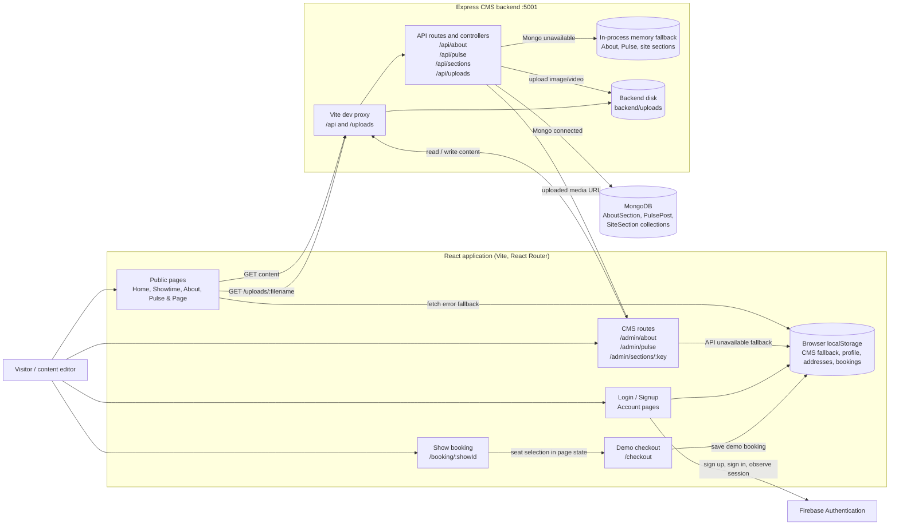
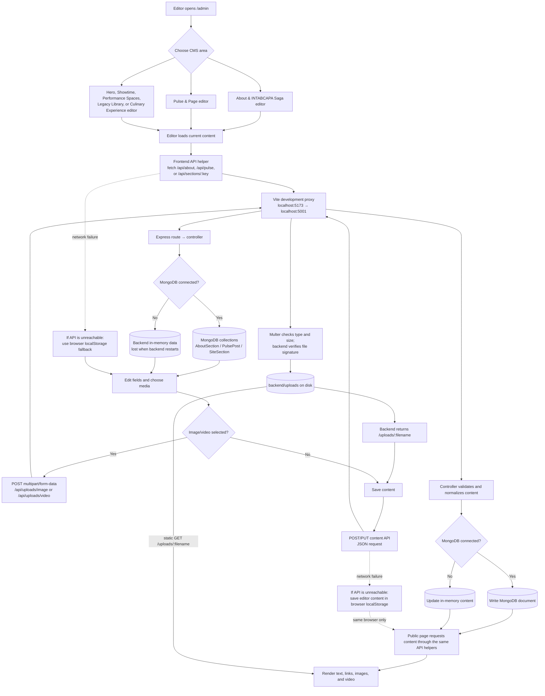
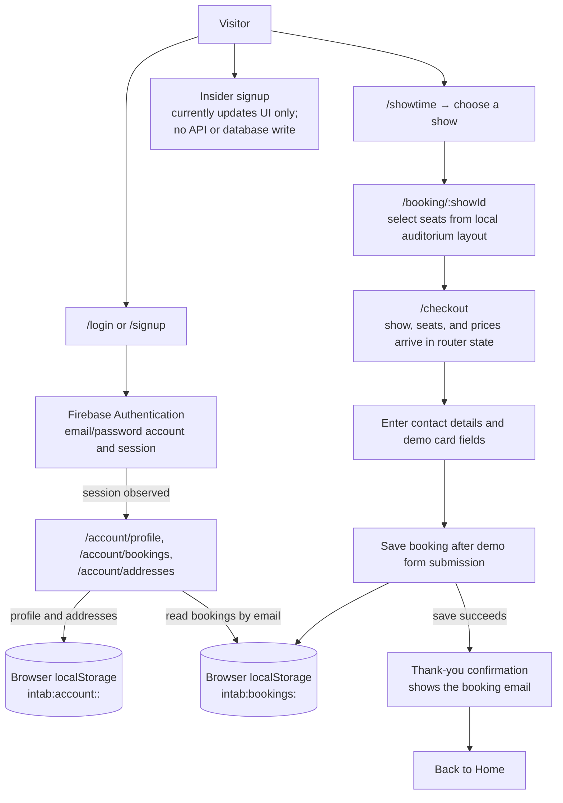

# Application, CMS, API, and data workflows

These diagrams describe the current implementation. The Vite proxy shown is
for local development; in production, `/api` and `/uploads` must be routed to
the Express backend by the hosting setup.

For a short visual introduction, see the [beginner-friendly workflow PDF](../pdf/application-workflow.pdf).
The [HTML source](./application-workflow.html) can be opened in a browser or
printed again.

## Application architecture

## CMS content and media traversal

### CMS API surface

| Resource | Requests | Stored data |
| --- | --- | --- |
| About | `GET /api/about`, `POST /api/about`, `PUT /api/about/:id`, `DELETE /api/about/:id` | `AboutSection` MongoDB collection, backend memory fallback, or browser localStorage when the API cannot be reached |
| Pulse & Page | `GET /api/pulse`, `GET /api/pulse/:id`, `POST /api/pulse`, `PUT /api/pulse/:id`, `DELETE /api/pulse/:id` | `PulsePost` MongoDB collection, backend memory fallback, or browser localStorage when the API cannot be reached |
| Site sections | `GET /api/sections/:key`, `PUT /api/sections/:key` | `SiteSection` MongoDB collection, backend memory fallback, or browser localStorage when the API cannot be reached |
| Media uploads | `POST /api/uploads/image`, `POST /api/uploads/video`; static reads from `/uploads/:filename` | Files on the Express server in `backend/uploads`; content records store the returned URL |

On initial reads, the backend seeds missing site sections and About content from
their defaults. The first Pulse read seeds the MongoDB collection with sample
posts when it is empty. The MongoDB URI is `MONGO_URI`; without it, the backend
uses `mongodb://127.0.0.1:27017/pulse-page`.

## Authentication, account, and booking data

Bookings and account profile/address data are not stored in MongoDB. Checkout is
a demo flow: it saves the booking in localStorage, does not process a payment,
and displays the confirmation screen only after the local save succeeds. When a
user is signed in, checkout associates the booking with the Firebase account
email; otherwise it uses the email entered on the checkout form.

## Operational notes

- `/admin` is a client-side CMS route; the current route tree does not add an
  authentication gate for CMS pages.
- Browser localStorage fallbacks are browser- and origin-specific. They do not
  synchronize with MongoDB or between users/devices.
- Backend in-memory fallbacks are process-local and are lost when the backend
  restarts.
- Uploaded media is stored on the backend filesystem, not in MongoDB or
  Firebase Storage.
- The Insider signup form currently has no persistence or mailing-list API.
